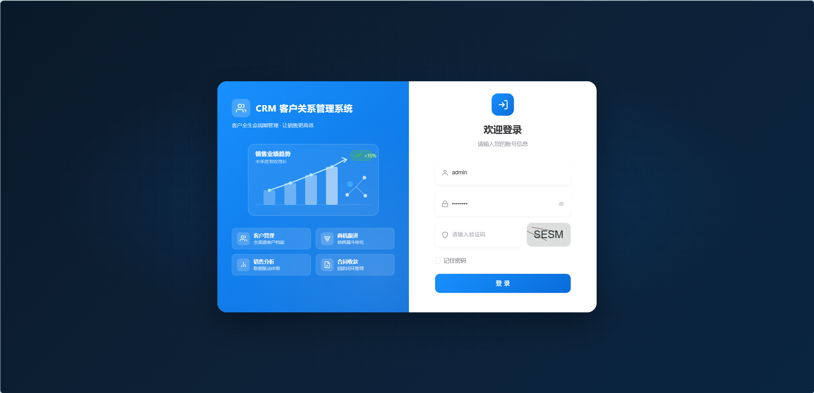
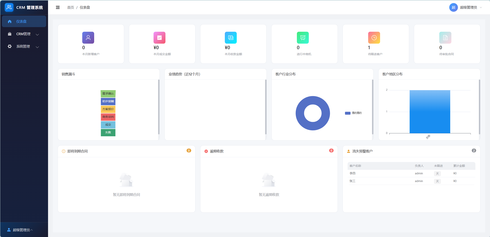
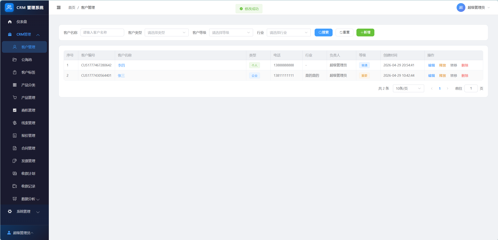
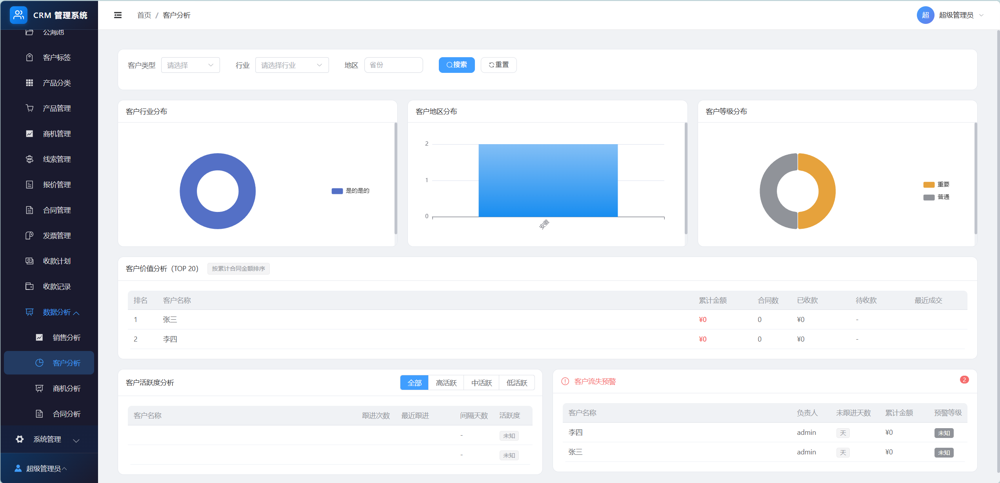

# CRM 客户关系管理系统

> 基于 Spring Boot 3 + Vue 3 的企业级 CRM 系统，内置多租户、数据权限、公海池等核心能力，可作为后台管理框架二次开发底座。

一个开箱即用的后台管理 + CRM 业务一体化解决方案，涵盖客户全生命周期管理：线索 → 商机 → 报价 → 合同 → 收款，并配套销售数据分析与预警。

## ✨ 特性

### 框架底座

- 🏢 **多租户架构**：基于 `tenant_id` 字段隔离，租户继承、自动填充、创建限制
- 🔐 **双 Token 认证**：Access Token（30 分钟）+ Refresh Token（7 天，Redis 存储）
- 🛡️ **细粒度权限**：菜单权限 + 按钮权限 + API 接口权限三层校验
- 🎯 **数据权限切面**：`@DataScope` 注解自动注入 SQL 条件，支持全部/本租户/本部门/部门及下级/仅本人五种范围
- 📝 **操作日志**：基于 AOP 自动记录接口操作与登录日志
- 📖 **API 文档**：SpringDoc OpenAPI 自动生成 Swagger 文档

### CRM 业务

- 👥 **客户管理**：企业/个人客户、联系人、跟进记录、标签体系
- 🌊 **公海池**：客户领取/释放/转移、超时未跟进自动释放（定时任务 + Redis 分布式锁）
- 🎣 **线索管理**：线索转化商机、跟进状态流转
- 💼 **商机管理**：阶段管理、赢单/输单关闭、销售漏斗
- 📦 **产品管理**：产品分类树、价格区间
- 📋 **报价管理**：报价单 + 产品明细、报价审批
- 📑 **合同管理**：审批流程（草稿→审批中→生效→终止）
- 🧾 **发票管理**：开票 + 作废
- 💰 **收款管理**：收款计划 + 收款记录 + 收款确认
- 📊 **数据分析**：销售仪表盘、业绩排名、客户分布、销售趋势、预警提醒

## 🛠️ 技术栈

### 后端

| 类别     | 技术                    | 版本     |
|--------|-----------------------|--------|
| 语言     | Java (OpenJDK)        | 17     |
| 框架     | Spring Boot           | 3.2.5  |
| ORM    | MyBatis-Plus          | 3.5.15 |
| 数据库    | MySQL                 | 8.0.33 |
| 认证     | Spring Security + JWT | 6.x    |
| 缓存     | Redis                 | -      |
| API 文档 | SpringDoc OpenAPI     | 2.5.0  |
| 工具库    | Hutool                | 5.8.27 |
| 对象映射   | MapStruct             | -      |
| 文件存储   | FastDFS               | 1.29   |

### 前端

| 类别    | 技术           | 版本   |
|-------|--------------|------|
| 框架    | Vue          | 3.5  |
| 语言    | TypeScript   | 6.0  |
| 构建工具  | Vite         | 6.3  |
| UI 组件 | Element Plus | 2.13 |
| 状态管理  | Pinia        | 3.0  |
| 路由    | Vue Router   | 5.0  |
| HTTP  | Axios        | 1.15 |
| 图表    | ECharts      | 5.6  |
| 图标    | Iconify      | 5.0  |

## 📦 项目结构

```
crm/
├── platform-parent/                  # 后端工程
│   ├── platform-common/              # 公共模块（全局依赖、工具、异常、上下文）
│   ├── platform-config/              # 配置模块（application.yml、SQL 脚本）
│   │   └── src/main/resources/db/
│   │       └── crm.sql      # 数据库初始化脚本
│   ├── platform-server/              # 业务服务模块
│   │   └── src/main/java/com/platform/server/
│   │       ├── auth/                 # 认证模块（登录、Token、安全）
│   │       ├── system/               # 系统管理
│   │       │   ├── user/             # 用户管理
│   │       │   ├── role/             # 角色管理
│   │       │   ├── menu/             # 菜单管理
│   │       │   ├── dept/             # 部门管理
│   │       │   ├── tenant/           # 租户管理
│   │       │   ├── dicttype/         # 字典类型
│   │       │   ├── dictdata/         # 字典数据
│   │       │   ├── config/           # 参数配置
│   │       │   └── log/              # 日志管理（登录/操作）
│   │       ├── crm/                  # CRM 业务
│   │       │   ├── customer/         # 客户管理（含公海池、联系人、跟进、标签）
│   │       │   ├── lead/             # 线索管理
│   │       │   ├── opportunity/      # 商机管理
│   │       │   ├── product/          # 产品管理
│   │       │   ├── quote/            # 报价管理
│   │       │   ├── contract/         # 合同管理
│   │       │   ├── invoice/          # 发票管理
│   │       │   ├── payment/          # 收款管理（计划+记录）
│   │       │   ├── analysis/         # 数据分析
│   │       │   └── task/             # 定时任务
│   │       └── common/               # 业务公共（上下文、查询基类、VO）
│   └── pom.xml
│
├── frontend-parent/
│   └── platform-admin/               # 前端工程
│       └── src/
│           ├── api/                  # API 请求模块
│           ├── views/                # 页面组件
│           │   ├── login/            # 登录
│           │   ├── system/           # 系统管理页面
│           │   └── crm/              # CRM 业务页面（含 dashboard、analysis）
│           ├── components/           # 公共组件
│           ├── composables/          # 组合式函数
│           ├── stores/               # Pinia 状态
│           ├── router/               # 路由
│           ├── types/                # 类型定义
│           └── utils/                # 工具函数
│
├── docs/                             # 设计文档（截图可放 docs/images/）
└── CLAUDE.md                         # 开发规范
```

### 业务模块分层

每个业务子模块遵循统一分层：

```
module/
├── controller/    # 接口层（REST API）
├── service/       # 业务层
│   └── impl/
├── mapper/        # 数据访问层
├── po/            # 持久化对象（数据库实体）
├── dto/           # 数据传输对象（请求入参）
├── vo/            # 视图对象（响应出参）
└── converter/     # 对象转换（MapStruct）
```

## 🚀 快速开始

### 环境要求

- JDK 17+
- Maven 3.8+
- Node.js 18+
- MySQL 8.0+
- Redis 5.0+

### 1. 初始化数据库

```bash
# 创建数据库
mysql -uroot -p -e "CREATE DATABASE crm DEFAULT CHARACTER SET utf8mb4 COLLATE utf8mb4_general_ci;"

# 导入初始化脚本（包含表结构 + 菜单 + 字典 + 初始账号）
mysql -uroot -p crm < platform-parent/platform-config/src/main/resources/db/crm.sql
```

> 初始账号：`admin` / `123456`

### 2. 配置后端

修改 `platform-parent/platform-config/src/main/resources/application-dev.yml`：

```yaml
platform:
  mysqldb:
    url: jdbc:mysql://127.0.0.1:3306
    urlArgs: ?useUnicode=true&characterEncoding=utf-8&useSSL=false&serverTimezone=Asia/Shanghai&allowPublicKeyRetrieval=true
    username: root
    password: your_password
    server:
      dbname: crm
  redis:
    host: 127.0.0.1
    port: 6379
    # password: your_redis_password
```

### 3. 启动后端

```bash
cd platform-parent
mvn clean compile -DskipTests
mvn spring-boot:run -pl platform-server -Pdev
```

- 后端服务：http://localhost:8081
- Swagger 文档：http://localhost:8081/swagger-ui.html

### 4. 启动前端

```bash
cd frontend-parent/platform-admin
npm install
npm run dev
```

- 前端服务：http://localhost:3000
- API 代理：`/api` 请求自动转发至 `http://localhost:8081`

### 5. 访问系统

浏览器打开 http://localhost:3000 ，使用初始账号登录即可。

## 📸 系统预览

| 登录页                           | 仪表盘                               |
|-------------------------------|-----------------------------------|
|  |  |

| 客户管理                              | 客户分析                              |
|-----------------------------------|-----------------------------------|
|  |  |

> 截图可放在 `docs/images/` 目录（`login.png` / `dashboard.png` / `customer.png` / `analysis.png`）；仓库默认未附带截图，可自行补充后替换上表引用。

## 📚 核心机制

### 数据权限

通过 `@DataScope` 注解自动注入 SQL 条件，无需在业务代码中硬编码：

```java

@DataScope(deptAlias = "d", userAlias = "u")
public PageVO<UserVO> getUserPage(UserQueryDTO query) {
    return userMapper.selectUserPage(query);
}
```

| 值 | 类型    | SQL 条件                   |
|---|-------|--------------------------|
| 1 | 全部数据  | 无条件（仅平台用户可选）             |
| 2 | 本租户数据 | `WHERE tenant_id = ?`    |
| 3 | 本部门数据 | `WHERE dept_id = ?`      |
| 4 | 部门及下级 | `WHERE dept_id IN (...)` |
| 5 | 仅本人数据 | `WHERE create_by = ?`    |

### 多租户

- 基于 `tenant_id` 字段隔离，MyBatis-Plus 插件自动注入
- 部门继承上级租户、新用户租户跟随部门
- 平台角色可跨租户管理，租户角色仅限本租户

### 公海池

- 客户领取（Redis 分布式锁防并发）
- 超时未跟进自动释放（定时任务）
- 客户转移、释放回公海池

## 🧩 API 路径规范

| 模块   | 路径前缀                   |
|------|------------------------|
| 认证   | `/api/auth`            |
| 用户管理 | `/api/system/user`     |
| 角色管理 | `/api/system/role`     |
| 菜单管理 | `/api/system/menu`     |
| 部门管理 | `/api/system/dept`     |
| 租户管理 | `/api/system/tenant`   |
| 字典管理 | `/api/system/dict`     |
| 日志管理 | `/api/system/log`      |
| 客户管理 | `/api/crm/customer`    |
| 线索管理 | `/api/crm/lead`        |
| 商机管理 | `/api/crm/opportunity` |
| 产品管理 | `/api/crm/product`     |
| 报价管理 | `/api/crm/quote`       |
| 合同管理 | `/api/crm/contract`    |
| 发票管理 | `/api/crm/invoice`     |
| 收款管理 | `/api/crm/payment`     |
| 数据分析 | `/api/crm/analysis`    |

## 🤝 参与贡献

1. Fork 本仓库
2. 创建特性分支：`git checkout -b feature/your-feature`
3. 提交更改：`git commit -m 'feat: add some feature'`
4. 推送分支：`git push origin feature/your-feature`
5. 提交 Pull Request

### 提交规范

遵循 [Conventional Commits](https://www.conventionalcommits.org/)：

```
<type>(<scope>): <description>

类型：feat | fix | refactor | docs | test | chore | perf | ci
```

## 📄 开源协议

本项目采用 [MIT License](LICENSE) 开源协议，可自由用于个人学习、商业项目二次开发。

---

如果这个项目对你有帮助，欢迎 ⭐ Star 支持！
